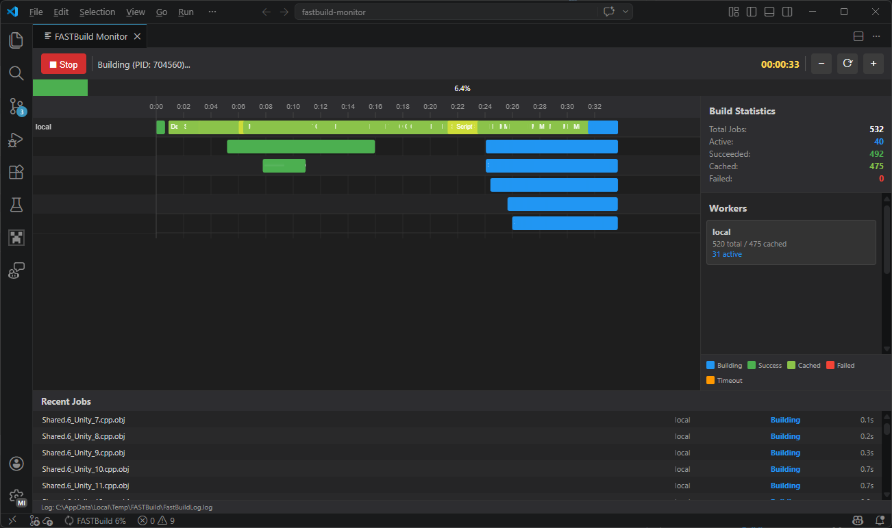

<h1 align="center">
  <br>
  FASTBuild Monitor
  <br>
</h1>

<h4 align="center">Real-time monitoring of <a href="http://www.fastbuild.org/">FASTBuild</a> distributed builds directly inside VS Code, with a Gantt-chart timeline, worker tracking, and build statistics.</h4>


<p align="center">

</p>


## Features

- **Timeline/Gantt chart** — Canvas-rendered visualization of build jobs across workers, color-coded by status. Bar labels use black text for at least 4.5:1 contrast against every status fill in all themes, including legacy mode.
- **Live job tooltips** — Hover over a timeline bar or Recent Jobs row for 350 ms for a themed, sectioned view of the full file/target path, host, status, timing relative to build start, and compiler output/diagnostics when available. Timeline tooltips also identify the virtual core/slot. Press Escape to dismiss.
- **Worker panel** — Live active/total/cached job counts per worker host
- **Workers summary** — Monitor footer shows remote worker count, remote cores, and local cores. Core counts reflect peak concurrent job slots observed per host in the current build, matching the timeline, rather than hardware core counts.
- **Build statistics** — Total, active, succeeded, cached, and failed counts
- **Progress bar** — Overall build progress percentage with automatically computed black/white text colors for the filled and unfilled portions. The label follows the animated fill boundary and theme changes without an added background.
- **Recent jobs list** — Scrollable feed of the latest jobs with status and timing.
- **Build Output** — Persistent output panel with a **Build Output** header and collapse/expand arrow matching **Recent Jobs**, an **All failures** filter (Failed, Error and Timeout) and individual-job filters, including jobs older than the Recent Jobs list. Double-click a timeline bar or Recent Jobs row, or choose **Show job output** in its tooltip, to inspect only that job. Compiler output refreshes with the build; missing output is reported explicitly.
- **Source navigation** — Click a compiler diagnostic in Build Output to open its file at the reported line and column. Supports MSVC `file(line[,column]):` and GCC/Clang `file:line[:column]:` locations. Relative paths are resolved against workspace folders; if several roots contain the file, you choose one. Absolute paths must be accessible to the extension host (remote paths in remote windows). Worker-only paths are not automatically remapped. Navigation uses the captured monitor output, so diagnostics must have been included in the FASTBuild monitor log.
- **Theme-aware text colors** — Readable status, statistics, and elapsed-time colors for light and dark themes; high-contrast themes use the theme foreground. Chart colors stay unchanged, and `fbuildMonitor.useLegacyColors` retains the original palette.
- **Status bar integration** — See build progress/status at a glance in the VS Code status bar
- **Zoom & scroll** — Ctrl + wheel zoom, plus zoom in/out/reset buttons. Hold the left mouse button in the timeline and drag to pan horizontally or vertically.
- **HTML export** — Click **Export HTML** to save the full timeline as a single, self-contained interactive HTML file and open it in your default browser. The viewer keeps the host/core rows, status colors, current theme colors, elapsed-time ticks (`m:ss`, or `h:mm:ss` for builds of an hour or more) and job tooltips, and supports Ctrl + wheel zoom, zoom/fit buttons and drag-to-pan. It draws only the visible part of the timeline, so builds with many thousands of jobs stay responsive. Running jobs are captured at export time.
- **Auto-start** — Optionally begin monitoring as soon as the panel opens


## Usage

1. Open VS Code
2. Run **FASTBuild Monitor: Show Build Monitor** from the command palette (Ctrl+Shift+P)
3. Launch your FASTBuild build with the `-monitor` flag:
   ```bash
   FBuild.exe -monitor ...
   ```
4. The monitor will pick up build events in real-time

### Exported timelines

Exports are written to `FASTBuildMonitor\timeline-<timestamp>.html` in the system temporary folder, and the path is shown in a notification. The file has no external dependencies, so it can be shared or archived; copy it elsewhere to keep it. When VS Code runs in a remote window, or the browser cannot be opened, the file opens in an editor instead so it can be saved locally and opened in a browser.

### Commands

| Command                                 | Description                 |
| --------------------------------------- | --------------------------- |
| `FASTBuild Monitor: Show Build Monitor` | Open the monitor panel      |
| `FASTBuild Monitor: Start Monitoring`   | Start watching the log file |
| `FASTBuild Monitor: Stop Monitoring`    | Stop watching               |

### Settings

| Setting                      | Default | Description                                                                                               |
| ---------------------------- | ------- | --------------------------------------------------------------------------------------------------------- |
| `fbuildmonitor.logPath`      | `""`    | Custom path to `FastBuildLog.log`. Empty = auto-detect from `%TEMP%\FASTBuild\` or `FASTBUILD_TEMP_PATH`. |
| `fbuildmonitor.pollInterval` | `500`   | Log file poll interval in milliseconds (100–5000).                                                        |
| `fbuildmonitor.autoStart`    | `true`  | Auto-start monitoring when the panel opens.                                                               |
| `fbuildMonitor.useLegacyColors` | `false` | Use the original fixed dark color scheme instead of colors derived from the active VS Code theme. |
